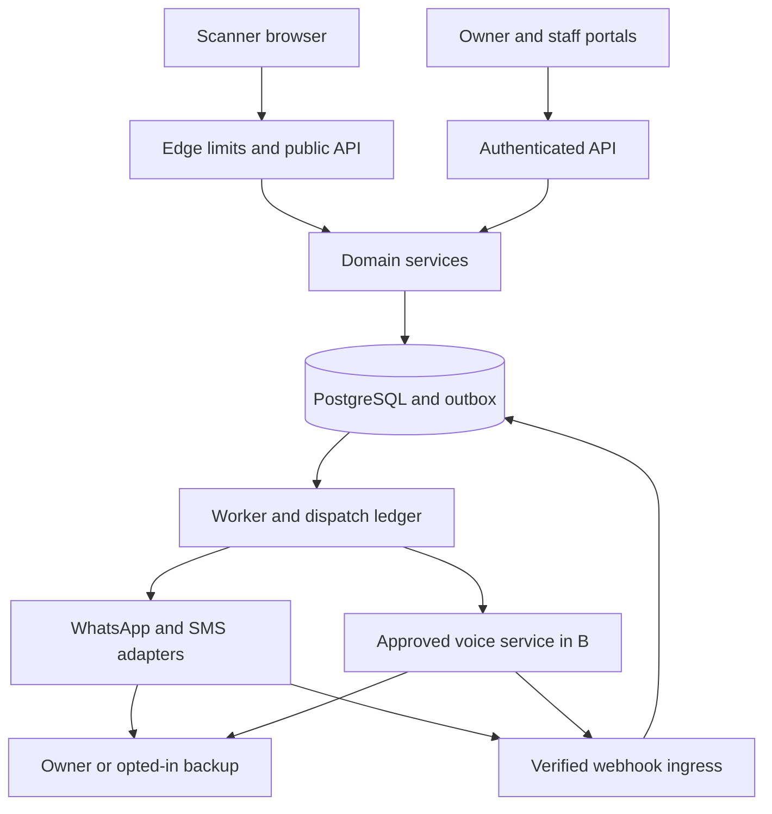

# Architecture

> Implementation update, 18–19 October 2026: application code now exists. This document preserves the planning baseline; see [docs/IMPLEMENTATION.md](docs/IMPLEMENTATION.md) and [docs/TESTING.md](docs/TESTING.md).

## Stack decision

| Layer | Proposed choice | Rationale |
|---|---|---|
| Web | Next.js + TypeScript + Tailwind | Scanner, owner, admin and site surfaces in one responsive codebase |
| Server | Next.js server endpoints + domain services | One modular application for the small team; avoid a second framework in A |
| Worker | Separate long-running Node.js process | Durable escalation and retries survive request termination |
| Database | PostgreSQL + Prisma migrations | Transactional ownership, incidents, outbox, unique dispatch keys |
| Queue | Redis + BullMQ | Scheduled tasks and bounded retries; DB remains source of truth |
| Identity | Maintained auth library/provider with verified phone integration | Session security, recovery and admin MFA; select during day-one spike |
| Messages | Meta Cloud API or official BSP; contracted SMS API | Separate adapters and receipts |
| Voice | Managed approved carrier API preferred; Asterisk + SIP alternative | B only, isolated service/network |
| Files | Private S3-compatible object storage | Print batch artifacts, later limited evidence uploads |
| Operations | Container web/worker, managed DB, CI, secrets manager, monitoring | Small service footprint with separate staging and production |
| Maps | Optional browser geolocation and map link; tiles later | Avoid a dependency for basic contact |

Exact supported versions are to be selected and pinned at kickoff, not guessed here. Current Next.js supports Node/Docker self-hosting [S15]. BullMQ documents retry/idempotency patterns [S16]. Do not run reliable timers only inside request handlers or ephemeral serverless functions.

## Trust boundaries

The public browser is untrusted. Public token access allows contact initiation subject to policy, never owner administration. Provider requests leave the service boundary. Staff and site scope checks run server-side, never only in navigation.

## Data flow and reliability

Create incident + outbox in one database transaction. An outbox dispatcher leases unsent rows and adds a queue job. Use a unique logical dispatch record per incident/channel/recipient/stage. Worker checks terminal incident state, consent, active tag, DND and budget under a short transaction, reserves dispatch, then makes the provider call outside the transaction. Store outcome and reconcile ambiguous timeouts. If provider lacks idempotency or status lookup, exactly-once external delivery cannot be guaranteed; do not blindly resend an uncertain accepted request. Prefer avoiding duplicate harassment to automatic endless retries.

Webhook ingress verifies signature against raw request bytes, records event ID/hash uniquely, acknowledges quickly and processes asynchronously. Out-of-order receipts cannot revert an incident’s owner acknowledgement. Separate incident outcome from message state. Scan page GET and link previews are side-effect free. Owner actions require authenticated identity or properly bound provider payloads.

## Logical state models

Incident: `OPEN → ACKNOWLEDGED → RESOLVED`, with `CANCELLED` or `EXPIRED` terminal alternatives. “Cannot attend” is an owner response event, not a false resolution. Delivery attempts independently track `QUEUED, SUBMITTING, ACCEPTED, DELIVERED, READ, FAILED, UNKNOWN`. Voice has `REQUESTED, SCANNER_VERIFIED, RINGING, ACCEPTED, BRIDGED, ENDED, FAILED`.

A public scanner sees only a safe projection of their incident. Do not expose last-seen timestamps, exact phone reachability, full registration plate or DND schedule. Owner response can be “Owner acknowledged” without identifying a backup contact.

## Deployment and operations

Use three isolated environments: local fake-provider development, staging with team-owned test phones and production with approved providers. Separate database, secrets, sender IDs and storage. Stage migrations and backward-compatible deployments. Store secrets in hosting secrets manager, never NEXT_PUBLIC variables, Git history, build output or monitoring attachments. Enable TLS, health checks, database backups and queue monitoring. Rate-limit before expensive OTP/provider operations.

CI: typecheck, lint, unit domain tests, migration validation, integration tests, production build, secret scan and focused browser flow. Protect main through review once collaborators join. Production deploy is a later explicit launch action, not part of this planning repository.

## Capacity starting assumptions

Design initial load test for 100 concurrent incident creations and a synthetic 10,000-tag dataset. These are test targets, not a forecast. Keep query indexes on token hash, owner, tenant, incident state/deadline, provider event and outbox availability. Use connection pooling and bounded worker concurrency. Avoid microservices, Kubernetes and a separate native app until measured pressure justifies them.

## Decisions to revisit

ADR01 web/PWA first; ADR02 modular monolith + worker; ADR03 explicit acknowledgement escalation; ADR04 metadata-minimal public gateway; ADR05 local voice independent of WhatsApp voice; ADR06 managed carrier preferred; ADR07 no mandatory GPS gate; ADR08 no public medical profile. Change only with evidence, date and migration impact recorded in memory.md.
