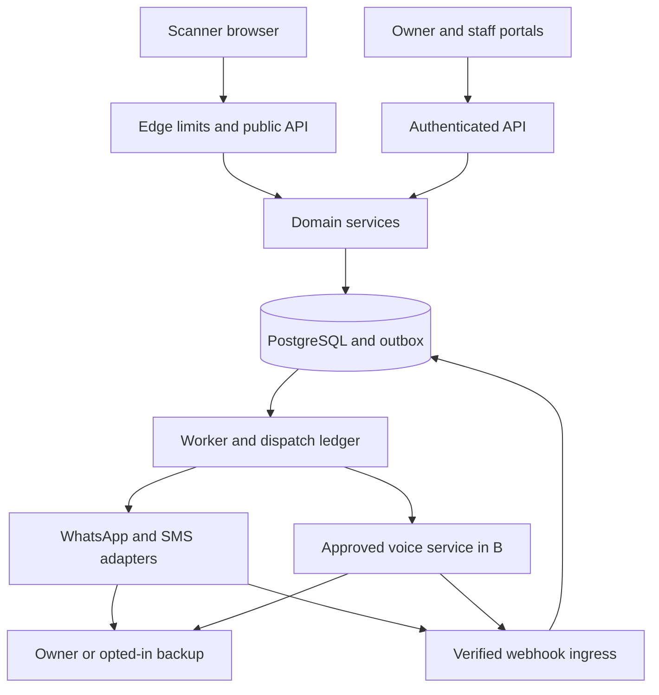
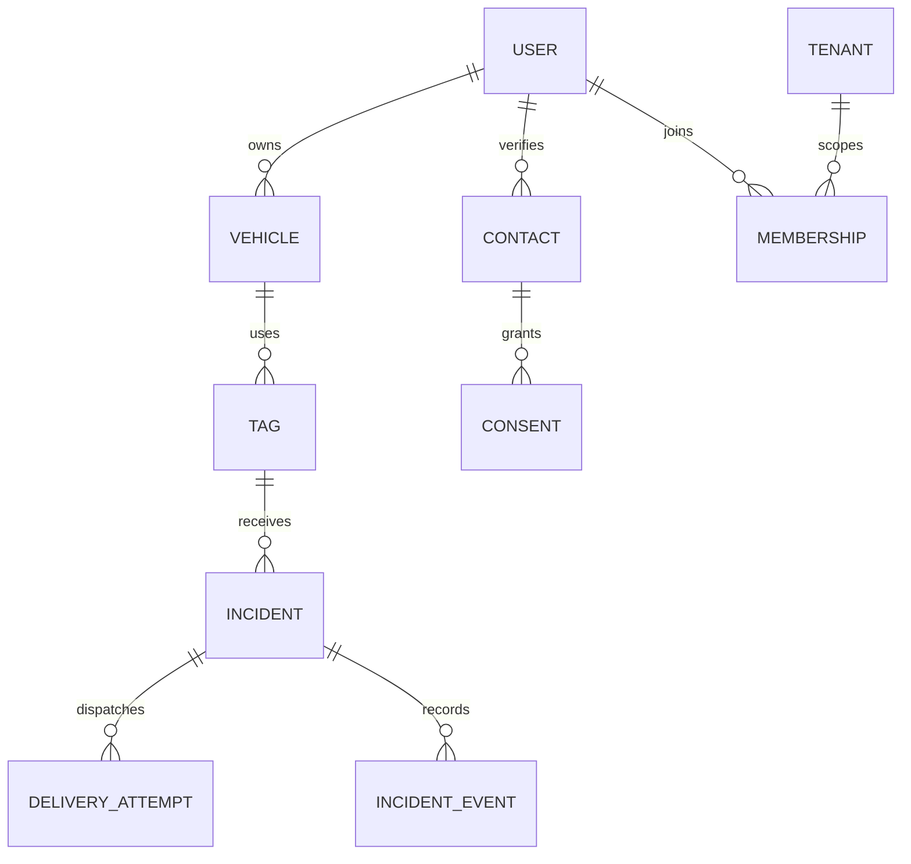

# QR CAR · Complete planning handbook

Research snapshot: 15 October 2026. Pre-development. This handbook consolidates the modular project documents. Provider approvals, supplier quotes and pilot outcomes remain pending. The GitHub files remain the editable source of truth.


---

Source file: `docs/00-decision-brief.md`

# Decision brief

## What to build

Build a private vehicle-contact service for a small, bounded parking community in Karachi, initially a campus, office or residential building. The owner registers, verifies their number, claims a sealed sticker and controls permitted contact methods. A passerby scans without an account, chooses a reason and receives an honest progress status. The service, not the passerby, knows the owner’s number.

The opportunity is a hypothesis: an institution may pay for fewer unresolved parking incidents and safer contact. Existing sellers already offer tags, private contact and sometimes community features. A QR code, Urdu, emergency contacts, weatherproof printing or B2B sales alone is not a defensible invention. The proposed advantage is a measured operational package: acknowledgement-based escalation, controlled guard access, deployment assistance and evidence of resolution time. Validate it against real competing products before claiming superiority.

## Decisions

| Question | Recommended decision | Reason / condition |
|---|---|---|
| Web or mobile? | Responsive web + owner PWA first | One codebase, scanner has no install barrier. PWA caching cannot deliver a new request without connectivity. |
| Native owner app? | Revisit after pilot | Build React Native/Expo only if measured push, retention or fleet needs justify cost. |
| A then B? | Yes, but start supplier feasibility on day one | Backend abstraction and consent model support B without waiting to discover carrier restrictions in month two. |
| WhatsApp number privacy? | Business account sends to owner privately | Never redirect to owner wa.me, tel, contact card or a group. The business/provider still processes phone numbers. |
| Offline owner? | WhatsApp plus time-based SMS escalation | SMS can arrive with cellular coverage and no mobile data. Explicit acknowledgement governs escalation, not read receipts. |
| Local call? | Approved carrier bridge in B | Verified scanner and owner receive business caller ID. Both cellular legs require service. |
| WhatsApp call? | Separate B experiment | Needs API access, permission, supported topology and policy review. It still needs internet. |
| Map? | Optional incident location | Scanner position is a report, not live car tracking or proof of proximity. |
| First release audience? | 50–100 consenting owners at 1–2 sites | Target, not acquired customers. Assess incidents and willingness to pay. |

## Corrections to supplied AI advice

| Earlier claim | Correction used in this plan |
|---|---|
| Less than 1% adoption | No defensible denominator or measurement supplied. Omitted. |
| Nearly 100% WhatsApp open rate | Unsupported. Measure delivery and owner acknowledgement in the pilot. |
| Delivered proves online; sent proves offline | Neither proves human availability. Webhook delay, device state and provider problems can explain statuses. |
| WhatsApp utility conversations have a generous free tier | Pricing moved to a per-message framework. Confirm current category, destination rate and exceptions, plus BSP fees [S08]. |
| SMS costs PKR 0.20–0.50 | No verified quote. All economics inputs are explicit assumptions. |
| Every competitor has every baseline feature | Public marketing differs and some pages conflict. Unknown remains unknown. |
| A 100 m GPS rule prevents abuse | Browser location can be denied, inaccurate or spoofed. There is no live car position from a static sticker. |
| Twilio cannot be used in Pakistan at all | Too broad. Confirm each product, destination, caller ID, contract and carrier route. No blanket conclusion. |
| Asterisk alone enables private local calls | It is a telephony engine, not a telephone number or licensed carrier agreement. |
| Two-minute delivery means success | Successful notification and successful parking resolution are different metrics. |
| A QR tag works without any connectivity | The URL can be decoded offline, but opening an uncached web flow and sending an alert need connectivity. |
| All stakeholders can see contact details | Owner and tightly restricted service roles only. Public APIs expose an allowlist. |

Sources and access limitations are in docs/09-sources.md. No plan can guarantee business success or a deadline controlled by outside providers.

---

Source file: `PRD.md`

# Product requirements · v1.0

Owner: Raazia Imran Reshamwala (project initiator). Team positions below are unassigned. Status: proposed scope for implementation. Phase A is mandatory first. Phase B remains part of the roadmap with external gates.

## Objective and scope

Help someone contact the responsible driver about a vehicle while keeping the driver’s phone number out of public pages and peer-to-peer contact metadata. Measure acknowledgement and resolution, while controlling harassment and channel cost. The platform and contracted communication providers necessarily process contact information.

Primary incidents: blocked exit/gate, lights on, window open, visible damage and urgent safety concern. For immediate danger, show instructions to seek local emergency assistance and site security. Do not promise emergency dispatch, rescue, towing avoidance, theft prevention or guaranteed response.

## Six human roles and service actors

| Role | Identity | Allowed | Not allowed |
|---|---|---|---|
| Scanner / passerby | Anonymous session for fixed alerts; verification for voice | View minimal tag page, submit reason, see own incident, cancel/report | Obtain owner number, enumerate vehicles, view unrelated incidents |
| Owner / registered driver | Verified phone, authenticated session | Claim tags, manage own vehicles, acknowledge, close, pause, block session, set preferences | Claim via public QR alone, read another owner’s data |
| Backup contact | Verified invited contact with separate opt-in | Receive agreed escalations, withdraw consent | Automatically become account owner or see history |
| Guard / site operator | Invited staff membership | Site-scoped incident creation and resolution assistance | Browse all personal numbers, export residents, see private chat by default |
| Site administrator | Tenant-scoped authenticated manager | Invite staff, allocate tag batches, see aggregate outcomes | Global administration or unrestricted owner contact access |
| Platform administrator / support | Strong authentication and separate permissions | Handle fulfilment, abuse, audits and provider failures | Unlogged contact disclosure, bulk PII export by default |

Platform admin divides into super-admin, support and fulfilment permissions. API workers and provider webhooks are non-human principals with least privilege. Backup and site roles can initially have limited workflows, but the data and authorization boundary must exist before site rollout.

## Twelve product modules

1. Marketing and onboarding: explanation, pricing disclosure, ordering enquiry, help, terms/privacy, language selection.
2. Identity: sign-in, OTP protection, verified channels, session/recovery, consent history.
3. Vehicle management: minimal make/color/optional plate, responsible driver, own vehicle list.
4. Tag lifecycle: batch generation, sealed activation secret, claim, pause, revoke, replace and transfer.
5. Scanner gateway: privacy-safe public page, reason buttons, optional location, incident submission.
6. Incident handling: explicit acknowledgement, status, cancellation, closure and report.
7. Channel orchestration: official WhatsApp, SMS fallback, durable jobs, receipts, retries and budgets.
8. Owner dashboard: incident inbox, history, acknowledgement, language, availability, backup invitation.
9. Administration: fulfilment, inventory, abuse review, channel health, audited changes, support.
10. Site operations: tenant membership, limited staff workflow, aggregate reporting and allocations.
11. Billing: pilot manual settlement, order reconciliation, later verified payment webhooks and quotas.
12. Phase B voice: callback verification, carrier sessions, consent, duration caps, usage and blocking.

## Screen inventory (30 planned routes / views)

| Surface | Screens / routes | Release |
|---|---|---|
| Public | Home; how it works; pricing/order; help/contact; privacy; terms | A |
| Identity | Sign-in; verify OTP; recovery; onboarding/consent | A |
| Scanner | `/q/:token`; reason/confirmation; `/incident/:id` progress; unavailable/revoked; abuse report | A |
| Owner | Dashboard; vehicles; claim tag; vehicle settings; incident detail; contact preferences; account/consent; transfer/replacement | A |
| Admin | Overview/health; inventory/orders; support/abuse; audit/access | A |
| Site | Site overview; staff/membership; site incident queue | A pilot minimal, B expanded |

Call request/OTP/progress dialogs extend scanner and incident screens in B. A backup invite/consent flow reuses onboarding, with restricted permissions. Payments can initially use pricing/order plus admin reconciliation. Screens may combine responsively, but authorization must not combine accidentally.

## Functional requirements

| ID | Requirement | Acceptance |
|---|---|---|
| FR01 | Sign in and verify phone ownership | Expiring, single-use OTP, attempt and resend limits; no full number in logs |
| FR02 | Separate channel consent | Record time, wording version and channel; revocation prevents future sends |
| FR03 | Atomic sticker claim | Valid sealed secret plus authenticated owner required; one winner under concurrency |
| FR04 | Minimal public response | No phone, email, address, internal user ID or secret in HTML, API or metadata |
| FR05 | Intentional contact | GET/QR scan alone sends nothing; confirmed POST creates an incident |
| FR06 | Fixed reason buttons | Allowlisted reason enum and translated labels; no arbitrary links in A |
| FR07 | Abuse controls | Per-tag/session/IP budgets, deduplication, adaptive challenge and owner pause |
| FR08 | Transactional incident creation | Incident and outbox commit together before worker processing |
| FR09 | WhatsApp alert | Approved template to verified opted-in owner with incident-bound actions |
| FR10 | Explicit acknowledgement | Owner “Coming” or authenticated reply records actor/time and cancels eligible jobs |
| FR11 | SMS fallback | At 90 s without acknowledgement, queue one SMS if permitted; known hard WhatsApp failure accelerates fallback |
| FR12 | Honest scanner status | Distinguish accepted, provider-delivered, owner-acknowledged, resolved and unreachable |
| FR13 | Safe backup escalation | At 180 s if configured, notify opted-in backup once; no automatic broadcasts |
| FR14 | End lifecycle | Default unresolved expiry 10 min; suppress late dispatch, retain safe history |
| FR15 | Owner controls | Pause, revoke, session-block, preferences, contact re-verification on change |
| FR16 | Transfer | Old owner consent or reviewed recovery, revoke old sessions and claim secret |
| FR17 | Admin accountability | Role checks and audit entries for mutations; support sees masked fields |
| FR18 | Tenant separation | Site staff access only their membership scope; bulk allocations cannot claim for owner |
| FR19 | Local voice | B only: verified scanner, explicit owner consent, approved caller ID, 120 s bridge cap |
| FR20 | Data rights | Documented export/deletion process, retention jobs and lawful hold handling |

## Flows

**Owner registration:** sign in → verify contact → consent → add minimal vehicle → enter sealed claim secret → test alert → place sticker. Treat control of tag and phone as account evidence, not legal ownership of a vehicle. Avoid collecting CNIC/registration documents by default.

**Scanner:** scan → inspect official domain → choose English/Roman Urdu/Urdu → choose reason → optional location permission → confirm → receive incident session → view acknowledgement. Fixed reason examples: “Please move your car” / “Gaari hata dein”; “Lights are on” / “Lights on hain”. Use proper RTL and reviewed Urdu translations before launch.

**Owner action:** WhatsApp quick reply or authenticated owner portal → Coming / Cannot attend / Report abuse. Owner dashboard can close after moving. Scanner can separately confirm cleared. Store who reported resolution. A forwarded SMS link cannot grant broad account access.

**Admin:** batch creation → print manifest → allocate/order → confirm dispatch → owner claims → support handles replacement using audited state changes. Site staff cannot activate someone else’s identity.

## Non-functional targets (proposed, not achieved)

Public page LCP ≤2.5 s in the chosen low-end Android test profile; accessible keyboard flow and 44 px touch targets; no horizontal scrolling at 360 px. API accepted response p95 <1 s excluding provider time. In a controlled 100-incident concurrency test, no duplicate logical sends or lost incidents. Monthly availability target 99.5% for pilot, measured from external probes, not a contractual SLA. Recovery point ≤24 h and recovery time ≤4 h initially, proven by restore test. Store all timestamps UTC and display Asia/Karachi.

## Exclusions from first month

Native apps, continuous GPS tracking, medical profiles, marketplace/sale mode, insurance-document vaults, ANPR, boom barriers, AI chatbots, unlimited free calling and mass marketing. Optional two-way free text should follow fixed alerts only after moderation and metadata redaction work. Do not delay the pilot for these.

## Release dependencies

Phase A real-world launch requires working approved WhatsApp templates, a contracted transactional SMS route, privacy/consent text, support availability and real device tests. If approvals slip, show a clearly labeled simulated demo, never market it as live. Phase B needs a signed-off carrier route and masking evidence. See roadmap.md and docs/08-acceptance-and-launch.md.

---

Source file: `docs/01-market-and-competitors.md`

# Pakistan market and competitor review

Research snapshot: 15 October 2026. This is a targeted public-web review, not an exhaustive census, paid mystery shop or technical penetration test. Search indexing and public websites establish published claims, not fulfilment quality, legal registration, installed base or actual call privacy. No competitor was contacted or purchased from.

## Direct and adjacent offerings

| Offering | Market / overlap | Publicly observed offer | Price observed | Evidence quality and open question |
|---|---|---|---|---|
| CarQR | Pakistan, direct, name collision | Vehicle QR privacy contact | Not verified | Official search extracts [S01]; page extraction limited. Obtain live demonstration and written tariff. |
| Amanat | Pakistan, direct | Parking stickers, masking claim, optional backup | PKR 499 one; 899 two; 1,699 four; delivery 99 | Full product page [S02]. Same page also says contact details are accessible; privacy implementation is ambiguous. |
| TrackMate | Pakistan, direct plus asset tags | Private gateway, chat and WebRTC audio | Car sticker PKR 1,499, displayed against 1,999 | Product catalog [S03]. Browser audio is not evidence of cellular fallback. Checkout says contact/COD. |
| Qonnect | Pakistan, direct/community positioning | QR contact and WhatsApp routing | Search extract PKR 1,780, one-time claim | [S04] indexed official content; direct page extraction weak. Pack/SKU and live price require reconfirmation. |
| Nishaaan | Pakistan, vehicle and asset tags | Finder identity step and anonymous bridge; glass/vinyl options | Vehicle price not verified | [S05] full page. GPS logging is a marketing claim, not proof of reliable location. |
| QrMyCar | India, product benchmark | Masked contact, WhatsApp/email, society flow | Not checked | [S06] describes owner and society use. Pakistan service/fulfilment not established. |
| CarQRCode / Abtara | India, product benchmark | Masked channels, reminders, base and premium plans | Mini from INR 99, premium displayed INR 50/year | [S07] promotional page. Generic FAQ conflicts with privacy promise; do not treat as tested. |
| Wheel-QR | Pakistan, adjacent | Vehicle sale/contact QR | Not verified | [S20] search evidence only. Sales focus differs from blocked-parking resolution. |
| Paper number card, guard phone tree | Existing substitute | Direct contact or staff intervention | Local cost varies | Operational alternatives to measure during pilot, not software competitors. |

“Scan to Move” appears in the supplied search text but a specific current official Pakistani operator was not sufficiently verified here. Institutional ANPR/gate systems are adjacent rather than interchangeable with a privacy contact tag. Do not copy unverified vendor lists into the pitch as confirmed competitors.

## What is already common

Private QR contact, scanner browser access, owner management and parking/emergency messaging recur across public descriptions. Several providers advertise wider use cases or community operation. Exact fallback, acknowledgement, DND behavior, number leakage, renewal limits, call topology and operating costs remain uncertain. “Not documented” must never become “competitor lacks it.”

## Positioning hypothesis

Sell a **managed parking contact service for one community**, with tags as the access point. Offer onboarding, a private contact path, acknowledgement-based escalation, staff boundaries and a short monthly outcome report. This is a proposed service bundle, not a verified market first. The defensible asset could become trusted institutional relationships, repeatable deployment and measured service performance, not the QR algorithm.

## Validation before large development spend

Interview 15 owners, 5 guards and 3 site decision-makers (targets). Ask about the last blocked incident, minutes lost, present workaround, willingness to display a tag, privacy fears, preferred alert and who would pay. Avoid leading questions about whether the idea is “good.” Obtain permission before recording.

Buy or arrange consented demonstrations of 2–3 direct competitors. On devices/accounts controlled by the team, test number visibility, acknowledgement, data-off owner, repeat scans, privacy settings and replacement. Record results with date, SKU and channel. Do not stress third-party systems or test strangers’ tags.

Pilot 50–100 consenting owners at 1–2 sites. Collect a baseline of comparable incidents and staff effort before intervention. Use scheduled drills if real incidents are sparse, but report drills separately. A suggested minimum is 30 evaluable incidents plus participant interviews; this is operational learning, not statistically conclusive proof.

## Market sizing without invented TAM

Start bottom-up. Reachable sites × vehicles per site × activation rate = potential activated tags in the reachable cohort. Example scenario: 10 accessible sites × 200 vehicles × 50% opt-in = 1,000 tags. These are assumptions, not Pakistan market data or signed demand. At PKR 80/site-sponsored active vehicle/month, the scenario gives PKR 80,000 MRR before churn, cost and taxes. Do not extrapolate it to the whole country.

Expand only if renewal willingness and contribution margin survive real provider costs. Low willingness to pay, rare incidents or adequate existing guard processes could invalidate the business even if the software works.

---

Source file: `docs/02-communications.md`

# Communications design and feasibility

## Four different channels

| Channel | Transport / endpoint | Who needs internet? | Number visibility | Release |
|---|---|---|---|---|
| WhatsApp message | Business Cloud API to owner | Owner for timely receipt; scanner for web request | Scanner sees business identity only; platform/provider knows owner | A |
| SMS | Transactional carrier/aggregator to owner | Owner does not need mobile data but needs cellular service | Platform sender displayed; owner number stays server-side | A fallback |
| Local masked call | Two carrier PSTN legs bridged by approved service | Web scanner for request; phones need cellular service | Approved business caller ID on both legs; verify on real handsets | B |
| WhatsApp / browser audio | Approved API VoIP or WebRTC | Both media endpoints need internet | Depends on topology and signaling; must audit | Separate gated experiment |

[S08–S14] support provider concepts. They do not constitute approval for this exact marketplace-like relay service. Do not use unofficial WhatsApp Web automation or SIM-box bypass routes.

## Phase A relay

A public QR contains only `https://<owned-domain>/q/<random-token>`. The API resolves the token privately. It never returns the owner’s destination number. The scanner chooses a reason and submits on our web page; a WhatsApp account is not needed for the scanner. The service sends an approved template to the owner from the business account.

Obtain explicit channel opt-in and a verified number. Verify business onboarding, sender eligibility, production permissions and billing. Use approved templates outside the owner’s 24-hour customer-service window. A scan by another person does not open the owner’s messaging window. Template category and approval are Meta decisions. Budget for delivered template messages under current rules and BSP charges; do not assume old free conversation tiers [S08,S09].

Suggested template draft, subject to approval: “A vehicle contact request was submitted for your registered tag {{1}}. Reason: {{2}}. Reference: {{3}}.” Quick actions: Coming / Cannot attend / Report abuse. Use fixed allowlisted variables, no arbitrary user URL. Do not include private owner identity in scanner responses. Inbound webhook sender and incident context must match the intended contact; reject stale/ambiguous actions. If several incidents exist, require selection by reference rather than “latest incident.”

SMS fallback must include the reason and incident reference in the body, so it is useful without opening an internet link. A link may supplement it. Receiving SMS is not an acknowledgement. If a provider supports two-way SMS, an incident-scoped keyword can acknowledge; do not assume an alphanumeric sender accepts replies. Otherwise offline owner may physically respond or use the B voice flow later.

## Proposed escalation policy

The timings below are configurable pilot defaults, not provider promises.

1. At t=0 persist incident and outbox atomically; enqueue WhatsApp. Return “Request received.”
2. Record accepted/sent/delivered/read/failure per attempt. Never label someone offline solely from a missing receipt.
3. At 90 seconds from incident acceptance, if not acknowledged/resolved/cancelled/expired, reserve one SMS fallback under a unique incident/channel/recipient/stage key. On permanent WhatsApp rejection, schedule SMS earlier. Transient failures get bounded retries within incident lifetime.
4. At 180 seconds, if still unresolved and not acknowledged, notify one explicitly opted-in backup if owner policy allows. This must not become a cascade to all contacts.
5. In B, a voice request requires deliberate scanner action and verification; no unsolicited automatic call storm. A site may enable a separately consented, rate-limited policy later.
6. At 10 minutes, mark unresolved incident expired and cease dispatch. Show “No acknowledgement yet; contact site staff if available.” Do not imply the vehicle moved.

Acknowledgement cancels future escalation. There is still an unavoidable race if a provider has accepted a message just before cancellation; log it rather than promising zero late notifications. Recheck terminal state and consent immediately before provider submission. Preserve explicit acknowledgement even if a delayed provider failure arrives later.

## Failure and connectivity cases

| Situation | Expected behavior |
|---|---|
| Owner data off, cellular on | SMS reason can arrive; B local call can ring once available |
| Owner phone off / no cellular coverage | No channel guarantees immediate contact; backup/site path if consented |
| Scanner has no internet | QR URL may decode but web alert cannot submit; printed business helpline + opaque code is a future IVR/manual fallback |
| WhatsApp restriction or provider outage | SMS through a separately contracted route, honest status, budget and incident expiry |
| Entire service unavailable | Static unavailable page if possible; no false confirmation; printed site help only with authorization |
| Owner sees delivered but ignores | Escalate based on lack of acknowledgement, subject to consent/DND and caps |
| DND enabled | Respect chosen policy, show contact unavailable without revealing schedule; urgent category must not silently override consent |
| Duplicate webhook / worker restart | Deduplicate event and dispatch; reconcile unknown provider outcome before unsafe retry |

## Phase B: local masked voice

Prefer a managed, licensed carrier-supported callback/bridge API if a supplier supports this use. Alternative: private Asterisk ARI/control service with approved SIP trunk. PTCL and Nayatel publish SIP products [S12,S13], but neither publication proves automatic third-party bridging or a specific caller-ID arrangement is approved.

Flow: scanner requests call → verify scanner phone and record consent → enforce destination/incident limits → call scanner with platform CLI → require keypress confirmation → dial owner with platform CLI → require owner acceptance → bridge for up to 120 seconds → tear down both legs and store minimal outcome. On busy/rejected/no answer, update status and do not retry indefinitely. Avoid connecting owner voicemail automatically; voicemail greetings may disclose identity. Explain that people can verbally reveal information during a call.

Do not expose a general-purpose dialing API. The backend chooses owner destination from the incident, restricts scanner country/destination class and rejects premium-rate/international abuse unless explicitly approved. One bridge uses two simultaneous call legs/channels. Shared platform caller ID can work without one virtual number per vehicle, but inbound callbacks need a safe menu and never a stale automatic mapping.

Provider gates: legal use approval; local CLI rights; +92 mobile network reachability and ported numbers; approved hosting/SIP routing; two-leg fees and rounding; capacity; KYC; fraud controls; webhook reliability; voicemail; retention; tax and deposits. Get written advice from carrier/regulatory counsel about requirements for this precise service. We have not established a universal Pakistan licensing answer from public sources.

## WhatsApp voice feasibility track

WhatsApp Business Calling exists, but it is a business API with eligibility, country, permission and topology constraints. It is not an API for silently linking two arbitrary personal WhatsApp accounts. Twilio documents restrictions on WhatsApp/PSTN connections [S11]. Keep the local phone bridge independent.

For a future in-app/browser-to-WhatsApp route, obtain written BSP approval for a vehicle-owner relay use case and check both endpoints, permission windows and allowed routing. Confirm caller identity on actual devices and inspect logs. Do not include WhatsApp voice in the committed first-month MVP. If unavailable, local voice B still meets the planned cellular fallback; WebRTC remains optional internet-dependent audio.

## Provider adapters

`sendAlert(incident, recipient, reason, idempotencyKey)`; `normalizeWebhook(raw)`; `getAttemptStatus(providerId)` where supported. Voice separately exposes `startVerifiedBridge`, `hangup`, `normalizeCallEvent`. Store provider identifiers, not secret credentials, in normal tables. Configuration chooses fake/test/live explicitly. Simulated receipts must never enter production outcome metrics.

---

Source file: `ARCHITECTURE.md`

# Architecture

## Stack decision

| Layer | Proposed choice | Rationale |
|---|---|---|
| Web | Next.js + TypeScript + Tailwind | Scanner, owner, admin and site surfaces in one responsive codebase |
| Server | Next.js server endpoints + domain services | One modular application for the small team; avoid a second framework in A |
| Worker | Separate long-running Node.js process | Durable escalation and retries survive request termination |
| Database | PostgreSQL + Prisma migrations | Transactional ownership, incidents, outbox, unique dispatch keys |
| Queue | Redis + BullMQ | Scheduled tasks and bounded retries; DB remains source of truth |
| Identity | Maintained auth library/provider with verified phone integration | Session security, recovery and admin MFA; select during day-one spike |
| Messages | Meta Cloud API or official BSP; contracted SMS API | Separate adapters and receipts |
| Voice | Managed approved carrier API preferred; Asterisk + SIP alternative | B only, isolated service/network |
| Files | Private S3-compatible object storage | Print batch artifacts, later limited evidence uploads |
| Operations | Container web/worker, managed DB, CI, secrets manager, monitoring | Small service footprint with separate staging and production |
| Maps | Optional browser geolocation and map link; tiles later | Avoid a dependency for basic contact |

Exact supported versions are to be selected and pinned at kickoff, not guessed here. Current Next.js supports Node/Docker self-hosting [S15]. BullMQ documents retry/idempotency patterns [S16]. Do not run reliable timers only inside request handlers or ephemeral serverless functions.

## Trust boundaries



The public browser is untrusted. Public token access allows contact initiation subject to policy, never owner administration. Provider requests leave the service boundary. Staff and site scope checks run server-side, never only in navigation.

## Data flow and reliability

Create incident + outbox in one database transaction. An outbox dispatcher leases unsent rows and adds a queue job. Use a unique logical dispatch record per incident/channel/recipient/stage. Worker checks terminal incident state, consent, active tag, DND and budget under a short transaction, reserves dispatch, then makes the provider call outside the transaction. Store outcome and reconcile ambiguous timeouts. If provider lacks idempotency or status lookup, exactly-once external delivery cannot be guaranteed; do not blindly resend an uncertain accepted request. Prefer avoiding duplicate harassment to automatic endless retries.

Webhook ingress verifies signature against raw request bytes, records event ID/hash uniquely, acknowledges quickly and processes asynchronously. Out-of-order receipts cannot revert an incident’s owner acknowledgement. Separate incident outcome from message state. Scan page GET and link previews are side-effect free. Owner actions require authenticated identity or properly bound provider payloads.

## Logical state models

Incident: `OPEN → ACKNOWLEDGED → RESOLVED`, with `CANCELLED` or `EXPIRED` terminal alternatives. “Cannot attend” is an owner response event, not a false resolution. Delivery attempts independently track `QUEUED, SUBMITTING, ACCEPTED, DELIVERED, READ, FAILED, UNKNOWN`. Voice has `REQUESTED, SCANNER_VERIFIED, RINGING, ACCEPTED, BRIDGED, ENDED, FAILED`.

A public scanner sees only a safe projection of their incident. Do not expose last-seen timestamps, exact phone reachability, full registration plate or DND schedule. Owner response can be “Owner acknowledged” without identifying a backup contact.

## Deployment and operations

Use three isolated environments: local fake-provider development, staging with team-owned test phones and production with approved providers. Separate database, secrets, sender IDs and storage. Stage migrations and backward-compatible deployments. Store secrets in hosting secrets manager, never NEXT_PUBLIC variables, Git history, build output or monitoring attachments. Enable TLS, health checks, database backups and queue monitoring. Rate-limit before expensive OTP/provider operations.

CI: typecheck, lint, unit domain tests, migration validation, integration tests, production build, secret scan and focused browser flow. Protect main through review once collaborators join. Production deploy is a later explicit launch action, not part of this planning repository.

## Capacity starting assumptions

Design initial load test for 100 concurrent incident creations and a synthetic 10,000-tag dataset. These are test targets, not a forecast. Keep query indexes on token hash, owner, tenant, incident state/deadline, provider event and outbox availability. Use connection pooling and bounded worker concurrency. Avoid microservices, Kubernetes and a separate native app until measured pressure justifies them.

## Decisions to revisit

ADR01 web/PWA first; ADR02 modular monolith + worker; ADR03 explicit acknowledgement escalation; ADR04 metadata-minimal public gateway; ADR05 local voice independent of WhatsApp voice; ADR06 managed carrier preferred; ADR07 no mandatory GPS gate; ADR08 no public medical profile. Change only with evidence, date and migration impact recorded in memory.md.

---

Source file: `docs/03-data-and-api.md`

# Data model and API specification

This is a design specification, not an implemented migration. UUIDs are internal IDs. Public QR tokens use at least 128 random bits from a cryptographic generator, encoded URL-safe. Hash tokens at rest for lookup. Never encode phone, plate or sequential database ID in QR. A separate sealed claim secret has at least 128 random bits and a one-time hashed verification record. Public token and claim secret must never be interchangeable.

## Entities and constraints

| Entity | Key fields | Rules |
|---|---|---|
| users | id, auth_subject, locale, status | Auth subject unique; deleted/disabled blocks writes |
| contacts | id, user_id, encrypted_e164, phone_hmac, verified_at, key_version | Envelope encryption; HMAC lookup with separate secret; changes require verification |
| consents | contact_id, purpose, channel, version, granted_at, revoked_at | Append evidence; no send after withdrawal |
| vehicles | id, owner_id, make, color, optional_plate, status | Owner authorization; optional plate private by default |
| tag_batches | id, created_by, quantity, manifest_uri | Private manifest, supplier access expires |
| tags | id, vehicle_id, token_hash, claim_secret_hash, state, batch_id | Token unique; atomic claim; states unclaimed/active/paused/revoked |
| backup_links | vehicle_id, contact_id, priority, accepted_at | Separate contact consent; at most one fallback in A |
| tenants / memberships | tenant_id, user_id, role, status | Composite uniqueness; mandatory tenant scope |
| incidents | id, tag_id, scanner_session_hash, reason, state, expires_at | Reason enum, foreign keys, owner determined from tag at creation |
| incident_recipients | incident_id, contact_id, role, destination_version | Immutable intended identity; recheck current consent before dispatch |
| incident_events | id, incident_id, actor_type/id, kind, time | Append-only outcome/audit events, safe payload |
| delivery_attempts | incident_id, recipient_id, channel, stage, provider_id, state | Unique logical dispatch tuple; reconcile unknown submissions |
| outbox | id, event_type, reference_id, available_at, lease_until, state | Atomic with domain transaction; bounded lease |
| webhook_events | provider, provider_event_id/hash, received_at, processed_at | Unique provider/event; short encrypted raw retention if needed |
| call_sessions | incident_id, verified_scanner_contact, leg_ids, state, duration | B; no arbitrary destination from client; no audio recording default |
| orders / order_items | order_id, buyer_id, amount, currency, payment_status, tag allocation | Server-side pricing; verified payment reference |
| abuse_reports / blocks | reporter, incident_id, target session/tag, expiry, reason | Do not globally ban shared IP without review |
| audit_logs | actor, action, target, timestamp, request_id | Redacted payload; protected write path |

## Relationship diagram



## API inventory

| Endpoint | Principal | Contract / access boundary |
|---|---|---|
| GET /api/public/tags/{token} | Public | Allowlist: active, generic vehicle descriptor, allowed reason codes, locale. Uniform unavailable result for invalid/revoked. |
| POST /api/public/tags/{token}/incidents | Public session + challenge if needed | Body reason, optional location. Idempotency-Key required; server decides destinations. |
| GET /api/public/incidents/{id} | Incident-bound session | Return safe state and allowed actions, no contact records. |
| POST /api/public/incidents/{id}/cancel | Same scanner session | Cancel only own open incident, prevents pending dispatch. |
| POST /api/owner/tags/claim | Auth owner | Sealed secret, tag token, vehicle ID; transactional one-use claim. |
| GET/POST /api/owner/vehicles | Auth owner | Owner scope; validation and minimal attributes. |
| PATCH /api/owner/vehicles/{id} | Owning user | Optimistic version; contact changes separately verified. |
| POST /api/owner/incidents/{id}/ack | Intended authenticated contact | Action coming/unavailable/report; cross-owner access denied. |
| POST /api/owner/incidents/{id}/resolve | Owner | Record actor, do not fabricate scanner confirmation. |
| POST /api/owner/tags/{id}/pause,revoke,transfer | Owner | Reauthenticate sensitive changes, audit; revoke active sessions where needed. |
| POST /api/webhooks/whatsapp | Provider | GET verification handshake + signed POST raw payload validation. |
| POST /api/webhooks/sms | Provider | Supplier-supported authentication and replay defense. |
| POST /api/voice/requests | Verified scanner, B | Incident ID only plus verification reference; server resolves target. |
| POST /api/webhooks/voice | Provider, B | Validate identity and event order. |
| GET /api/site/incidents | Site membership | Tenant scope, redacted incident projection. |
| POST /api/admin/tag-batches | Fulfilment/admin | MFA, quantity cap, secure print artifact generation. |
| GET /api/admin/health | Operations | Aggregate channel failures, spend, backlog, no phone fields. |

contracts/openapi.yaml defines the first vertical slice only; the inventory above defines remaining routes for later implementation. Document error schemas consistently: invalid input 400, unauthenticated 401, unauthorized/not-found without enumeration 404 where appropriate, conflict 409, rate limit 429, retryable server error 503. Never return provider raw errors to public clients.

## Session and concurrency details

Use secure, HttpOnly, SameSite cookies and CSRF defenses for cookie-authenticated mutations. Public incident sessions use high-entropy opaque credentials, expire with the incident and are not indexed. Strip tokens from analytics and referer headers. A scanner session is not proof of a person’s identity. Voice requires a separately verified callback number. Idempotency keys bind principal+route+canonical body; reuse with different body is a conflict. Row-level lock/conditional UPDATE and unique constraints enforce claims, not frontend checks.

---

Source file: `docs/04-security-and-privacy.md`

# Security and privacy design

## Privacy promise

“The scanner does not receive the owner’s phone number through our public interface.” This is testable. “100% anonymous,” “unhackable,” “no privacy risk” and “guaranteed emergency contact” are not acceptable claims. The platform, telecom/WhatsApp providers and narrowly authorized personnel process contact data. A person may disclose identity in speech or a message; do not promise to prevent all human disclosure.

## Threat model

| Threat | Control | Verification |
|---|---|---|
| Number leaks through API, HTML, hydration, error or source map | Public DTO allowlist, encrypted contacts, log redaction, no owner tel/wa.me links | Inspect browser network, source, metadata and error paths with seeded test number |
| Public sticker claim theft | Separate sealed claim secret, OTP and atomic one-time claim | Concurrent two-user claim test; public QR alone must fail |
| QR copying or photographs | Revoke/rotate, session/tag limits, abuse review | Copied token still cannot be treated as proof of physical proximity |
| Sticker replacement/phishing | Official domain on sticker, tamper evidence, education and reporting | Physical onboarding demonstration; avoid generic URL shorteners |
| Harassment and spend attack | No alert on scan GET; reason-only A, per-incident/tag/IP/session caps, adaptive challenge | Replay/load tests and usage circuit breaker |
| IDOR / cross-tenant data access | Server-side owner and membership checks on every object | A/B owner and tenant fixtures for every route |
| Forged provider callbacks | Signature on raw body, event dedupe, short verification endpoint | Invalid signature and duplicate/out-of-order events |
| OTP abuse/account takeover | Short-lived single-use codes, max attempts, resend cooldown, admin MFA | Brute force, reuse, number-change and recovery scenarios |
| Sensitive SMS link forwarding | Scoped link, short expiry, authenticated sensitive action | Forwarded link cannot access account or other incidents |
| Telephony toll fraud | Verified scanner, allowlisted destination classes, per-account budgets, duration cap | Attempts to override destination and simultaneous bridge test |
| Staff misuse | Least privilege, masked contacts, reason-based break-glass and audit | Support account cannot bulk export or silently unmask |
| Map stalking | Optional permission, no public owner map/history, short retention | Denied GPS still permits alert; logs omit coordinates by default |

## Abuse defaults for pilot

Proposed tunable values: one active incident per tag+scanner session per 5 minutes, 3 submissions per tag in 10 minutes, adaptive challenge at risk threshold, 10 public submissions/IP/hour with allowances for shared institutional networks. OTP 5 guesses/code, 60-second resend delay and daily recipient/IP limits. Provider spend has a daily platform cap and per-tenant cap. Operators must be able to pause a tag/channel quickly. These are initial policies to calibrate, not universal safe values.

Restrict A to preset reasons. If free text arrives later, limit length, escape HTML, prevent links/attachments initially, support reporting and explain voluntary PII leakage. Do not blindly forward raw WhatsApp sender metadata or quoted contact cards to the other party.

## Proposed retention policy, subject to review

| Data | Proposed retention | Reason |
|---|---|---|
| Active account/contact | While account active | Service delivery and recovery |
| Incident text/status | 30 days | Support and pilot outcomes |
| Exact optional incident GPS | 24 hours | Immediate assistance only; no location history |
| Raw webhook payload | 7 days max if needed, encrypted/redacted | Provider debugging |
| Redacted security/access audit | 90 days | Abuse investigation |
| Call metadata | 30 days | Reconciliation; no audio recording default |
| Backups | 30-day rolling policy | Recovery; deletion propagates on expiry |
| Financial records | Period confirmed by accountant/legal review | Do not invent a statutory term |

Define deletion jobs and evidence, not just policy text. Review lawful holds and contractual retention before deleting relevant records. Data export excludes third-party private content. Contact verification and consent records must support provenance without indefinitely retaining unnecessary payloads.

## Provider and legal review

Confirm lawful route, sender registration, commercial relay use, consent, DND/opt-out handling, data processing agreements, cross-border processing, breach escalation, refunds, tax and retention. No blanket conclusion that a particular PTA license is always required or never required is made here. Obtain written service-specific advice before voice launch. Do not treat internet searches or a corporate SIP product page as regulatory approval.

## Production controls

TLS, encrypted secrets and phone fields, separate encryption/lookup keys, rotation plan, restricted DB role, parameterized access, CSP, secure cookies, no shared admin passwords, admin MFA, audited backups and restore drills. Never commit production data in tests or pitch examples. A privacy incident stops rollout until containment, user communication obligations and remediation are assessed.

---

Source file: `docs/05-operations.md`

# Stickers, maps, payments and support

## Sticker production workflow

1. Register and secure a distinctive domain before printing live stock. The repository name can remain carQR; commercial naming must avoid confusion with CarQR Pakistan.
2. Generate random public token and independent sealed activation secret. Store hashes; produce a private print manifest with minimum necessary information. Printing supplier must not receive phone numbers.
3. Public artwork includes readable official domain, contact purpose, QR, opaque support code and brief language cue. The secret belongs under a scratch panel or sealed packaging, never exposed on windshield.
4. Encode HTTPS URL only, not phone/plate/vCard. Use a tested QR library, four-module quiet zone, high contrast and error correction suited to damage. Avoid decorative logos covering modules.
5. Prototype an approximately 70×50 mm label with a QR around 30–35 mm square; these are design starting dimensions, not a guaranteed scanning specification. Test the actual URL/module density and material before ordering.
6. Request quotes for reverse-printed inside-glass UV-protected vinyl/static cling and outside-use laminated alternative. Reverse printing must leave the code correctly readable from outside. Get samples and written material specifications; do not claim five-year life without evidence.
7. Test sunlight, glare, tinted glass, dust, low light, older cameras, viewing angles and practical distance. Record sample ID and phone. Test adhesion/heat exposure safely; do not obstruct driver vision, sensors or required markings.
8. Print a 20-piece engineering sample first, then pilot quantity after acceptance. Track batch, fulfillment, activation and replacement. Destroy spoiled claim secrets and limit supplier file retention.

Owner activation must be self-service with the secret and verified contact. A public scan of an unclaimed tag shows generic activation/help, never permits takeover without the secret. A replacement normally gets a new token and revokes the old one. Transfer requires explicit release/recovery review and invalidates previous sessions.

## Maps

A QR sticker has no GPS radio. Optional browser geolocation describes the scanner’s reported device location at that time. It does not establish the car’s actual position and can be spoofed or denied. Store accuracy and timestamp when accepted. A textual “Gate B / basement level 1” may be more useful than GPS indoors.

MVP: reason plus optional location text, and an owner-only map link when coordinates are voluntarily supplied. No map is required to submit an alert. Later: MapLibre/Leaflet with a licensed tile service and visible attribution. OpenStreetMap data availability does not grant unlimited use of the public tile servers [S17]. Document map vendor costs and data processing. No mandatory 100 m geofence in A, no public car tracking and no implicit continuous location permissions.

## Order and payment workflow

Pilot can use an invoice/manual bank or supported local payment collection with explicit reconciliation. A screenshot is not payment proof: verify settlement/reference with authorized merchant access before marking paid. Never collect card credentials. Record order, allocation, price, refund and fulfillment independently from activation.

Later integrate JazzCash/Easypaisa or an approved gateway only after merchant eligibility, fees, settlement, refunds and webhook verification are documented. Client callbacks cannot set paid status. A verified signed provider event and reconciliation control the state. Do not advertise unsupported payment logos as live integrations.

## Site operation

Obtain site permission, designate a staff sponsor, explain privacy and train guards on the scanner flow. Distribute tags to consenting owners and run a test alert. Site administrator sees activation counts and incident summaries. Guard access is site-scoped; no directory of personal numbers. Maintain a daily unresolved/failed-delivery review during pilot.

Support handles failed activation, lost packaging, changed phone, compromised tag, unwanted contact and refunds. Recovery never relies on reading the public QR. Keep an audited manual review path and a defined response window chosen according to team availability; do not claim 24/7 support without staffing it.

## Operating runbook

Monitor API health, outbox age, queue delay, provider rejection, SMS fallback rate, unknown attempts, spend and abuse reports. On a channel outage: disable new dispatch if unsafe, retain incidents, respect expiry, use the independent approved fallback and show honest status. On credential leak: revoke/rotate, contain access, inspect audit evidence and assess notification duties. On DB failure: pause writes, restore tested backup, reconcile provider submissions before retries. On excessive tag abuse: pause that tag, notify owner through a safe channel and investigate.

---

Source file: `docs/06-business-and-economics.md`

# Business model, pricing experiments and budget

All amounts below are planning assumptions in PKR, not quotations, forecasts or achieved revenue. Published competitor prices are in the competitor document. Provider tariffs, taxes, payment fees, delivery returns, support effort and currency conversion must replace assumptions before accepting paid commitments.

## Buyer and distribution

Start with one accessible university/office/building operator, where a named champion can organize installation and measure incidents. Owner is the user; institution may be payer; scanner is occasional and should not pay to report a blocked gate. A site-sponsored service may reduce individual acquisition cost, but sales and approvals may be slow. In parallel, test whether a small direct-to-owner cohort values paid cellular fallback.

Offer clear duration and usage limits. Avoid “lifetime unlimited” WhatsApp/SMS/voice because costs recur. Do not compete solely on sticker price. Candidate experiments: basic annual messaging entitlement with fair-use limits; premium local calling allowance after B; site setup plus monthly active-vehicle fee. Do not charge for features still gated or simulated.

## Illustrative first-year D2C unit economics

| Input | Assumption PKR per activated owner |
|---|---:|
| Selling price including first-year service | 999 |
| Printing and packaging | 120 |
| Delivery allocation | 180 |
| Payment/collection cost | 30 |
| Acquisition cost | 150 |
| Support/replacement reserve | 80 |
| 12 alerts × (WA 3 + 25% × SMS 2) | 42 |
| Total variable cost | 602 |
| Contribution before fixed costs, tax and founder labor | 397 |

With assumed fixed monthly costs of 25,000, about 63 new sales/month cover those fixed costs at this first-year contribution. This is **not recurring subscription break-even**: service liabilities remain after sticker sales, renewals/churn matter, and founders are unpaid in the scenario. If acquisition rises to 300 and delivery to 250, contribution drops to 177 and approximately 142 sales/month are needed. If alert volume rises to 120/year with the original other assumptions, contribution falls to 19. This shows why usage caps and pricing tests matter.

The reproducible calculator is tools/economics.py. It uses a ceiling for break-even volume. Actual margin may be negative. Provider billing may differ for delivered messages, failed calls, rounded minutes, setup fees or minimum commitments.

## Voice economics

For a bridge, estimate `ceil(scanner_leg_seconds/billing_unit)×scanner_rate + ceil(owner_leg_seconds/billing_unit)×owner_rate + platform_fee`. A 2-minute connected conversation can involve more than 4 charged leg-minutes if ringing/rounding is billable. Add number rental, minimum trunk capacity, deposits, taxes and fraud reserve. Sell a capped allowance only after measured cost per completed call. Do not assume a low local consumer SIM tariff applies to a business trunk.

## Site scenario

10 reachable sites × 200 eligible vehicles × 50% activation = 1,000 active tags (illustrative). At an experimental site-sponsored PKR 80/active tag/month, gross MRR = 80,000. Subtract channel usage, support, onboarding, payment, infrastructure and tax. No signed sites, users, contracts or recurring revenue are claimed. Quote setup and replacement separately; validate institutional procurement and renewal willingness.

## Two-month cash envelope (excluding founder salaries)

| Item | Planning range PKR | Gate |
|---|---:|---|
| Domain, infrastructure, backups, monitoring | 15,000–35,000 | Choose host, billing currency and data region |
| WhatsApp/SMS setup and test credit | 5,000–20,000 | Quotes and minimum commitments |
| Samples, pilot print and distribution | 10,000–25,000 | Material samples and local quote |
| Discovery, travel and support materials | 5,000–15,000 | Actual site access |
| Subtotal Phase A allowance | 35,000–95,000 | Assumptions only |
| 20% contingency | 7,000–19,000 | Keep reserve |
| Total Phase A allowance | 42,000–114,000 | Excludes salaries, legal/tax fees and B carrier deposits |

Phase B cash budget remains **TBD by written carrier quote**, not zero. Estimate founder time separately: 2 developers ×20 h/week ×8 weeks =320 developer-hours, plus 40–64 product/QA hours. A narrower solo 15 h/week plan yields only120 hours in eight weeks and cannot reasonably promise the same scope.

## Metrics and business gates

Activation = activated tags / distributed tags. Meaningful incident = a consented non-test contact, excluding abusive duplicates. Acknowledgement time = confirmed owner response minus incident acceptance. Resolution time needs explicit owner/scanner/staff evidence, with actor recorded. Channel delivery and human resolution remain separate.

Pilot targets: ≥70% activation, ≥80% of eligible controlled incidents acknowledged within 3 minutes, zero public phone leaks in defined tests, acceptable per-incident cost, and at least 2 site decision-makers willing to discuss a paid continuation. These are targets, not results. Report sample counts, network conditions, failure causes and drills separately. A useful product with no renewal interest is not yet a validated business.

## Launch and growth

Before launch: interviews, competing product tests, provider feasibility and name clearance. Pilot: assisted setup, bilingual signage, weekly issue review and baseline comparison. After evidence: publish consented aggregate outcomes, add nearby institutions, test accessory-shop distribution and referrals. Avoid broad paid ads until first-year contribution and support burden are understood. Stop or pivot if privacy, carrier cost or lack of demand defeats the proposition.

---

Source file: `roadmap.md`

# Roadmap and staffing

Planning baseline: start 16 October 2026, subject to team availability. Two developers at 20 focused h/week each plus product/QA 5–8 h/week. Feature estimates include some integration/testing but not provider approval lead time. Do not interpret dates as guarantees.

## Two weeks: 16–29 October · demonstration and feasibility

| Working day | Deliverable | Owner role | Exit evidence |
|---|---|---|---|
| 1 | Scope freeze, repo conventions, provider enquiries prepared, auth spike | Both + product | Scope accepted, gaps recorded |
| 2 | DB/tag design, public DTO, basic scanner and owner layout | Dev A/B | Sample schema and no-PII response |
| 3 | Authentication/OTP abstraction, consent and claim flow | Dev A | Atomic claim test |
| 4 | Scanner reason flow, incident/session APIs | Dev B | Real browser can submit safely |
| 5 | Outbox, worker and fake providers | Dev A | Restart-safe dispatch simulation |
| 6 | Owner acknowledgement and scanner status | Dev B | End-to-end simulated incident |
| 7 | WhatsApp test integration and signatures | Dev A | Approved team test message or labeled simulation |
| 8 | SMS adapter and fallback timer | Dev A/B | Data-off scenario if supplier ready |
| 9 | Minimal admin, abuse caps, print samples | Both + product | Staff permissions and sample scans |
| 10 | Test, demo rehearsal, pitch and gate review | Whole team | Demo, known limitations and next decision |

A two-week full production A+B release is not credible under these assumptions. Demo may use clearly labeled provider simulations if approval is pending. Never fake live receipts in a pitch.

## First month: through 12 November · Phase A controlled pilot target

Week 1: architecture, identity, secure tag claim, provider onboarding in parallel with development.
Week 2: incident, outbox, WhatsApp, acknowledgement and SMS vertical slice.
Week 3: admin/support, language review, rate limits, backup consent, real carrier tests and production configuration.
Week 4: privacy audit, restore rehearsal, printed sample acceptance, 50–100-owner site pilot if all gates pass. Review incidents weekly. Delivery approval delays move the pilot, not privacy or testing gates.

## Second month: through 10 December · hardening and conditional Phase B

Week 5: pilot fixes, bounded tenant/staff dashboard, support process, actual cost model.
Week 6: approved carrier integration, scanner verification, call acceptance and teardown.
Week 7: all-network masking tests, toll-fraud controls, billing reconciliation and rollback drill.
Week 8: limited B pilot if supplier/legal/privacy gates pass; renewals and next-stage pitch with real outcomes. WhatsApp voice has an independent feasibility decision and can remain deferred.

## Critical path

Business sender/template approval and SMS route → real A integration → offline-owner tests → pilot. Carrier commercial use approval/CLI/trunk → local bridge integration → handset masking/fraud tests → B pilot. Start provider work on day one even though A ships before B. Printing depends on final domain and secure activation design.

## Capacity and trade-offs

If solo: preserve scanner, owner, tag claim, WhatsApp, SMS, support and security. Defer self-service checkout, broad sites dashboard, native app and free-text chat. Expect four-week demo/closed alpha and eight-week limited A pilot depending on hours; B may slip. If providers are unavailable: continue mock/demo and interviews, but do not advertise cellular fallback as live.

## Estimated workload

The detailed backlog currently totals 201 developer-hours: 140 through the Phase A pilot preparation and 61 for follow-on hardening/voice/reporting. The four-week developer capacity assumption is 160 hours, leaving only 20 hours of initial buffer. Provider waiting, interviews, printing, site recruitment and legal review are additional calendar/product work. Re-estimate after the first vertical slice; the month-one target is ambitious for a learning team. The eight-week 320-hour capacity leaves more integration reserve, but external approvals still govern Phase B.

## Definition of done

Code reviewed, meaningful tests pass, user-visible states honest, permissions verified, provider cost measured where applicable, deployment reversible, documentation updated and no secrets committed. “Merged” alone does not mark a feature done. Track work in TASKS.md and planning/backlog.csv.

---

Source file: `TASKS.md`

# Task board

Every implementation item is **TODO**. Research and planning preparation are complete; supplier validation and product development are not.

## Ready first

- [ ] K01 Confirm team hours, budget and first site access
- [ ] K02 Choose distinctive brand/domain after clearance
- [ ] K03 Validate WhatsApp onboarding and template requirements
- [ ] K04 Obtain transactional SMS route and quote
- [ ] K05 Obtain voice-use/CLI feasibility in parallel
- [ ] K06 Interview owners, guards and site buyers
- [ ] K07 Set up app workspace, pinned dependencies and CI
- [ ] K08 Implement auth/OTP/consent spike

## Phase A construction

K09–K27 in planning/backlog.csv cover schema, secure tag claim, scanner, outbox, worker, providers, acknowledgement, escalation, owner/admin, localization and support. Follow dependencies rather than assigning all tasks simultaneously.

## Pilot gate

K28–K34 cover print tests, provider device tests, security, operations, site rollout and evidence review. A completed demo does not satisfy this gate.

## Phase B and growth

K35–K42 cover approved voice bridge, verified scanner, privacy/cost tests, conditional WhatsApp voice, site expansion and paid validation.

## Task status vocabulary

TODO → IN_PROGRESS → REVIEW → VERIFIED → RELEASED. BLOCKED includes the exact external dependency and responsible role. CSV includes estimated developer-hours; external waiting time and product/QA time are separate. Re-estimate at kickoff and weekly.

## GitHub execution issues

- [E01 · Provider feasibility and launch prerequisites](https://github.com/Raazia-Imran/carQR/issues/1)
- [E02 · Identity, secure tags and ownership](https://github.com/Raazia-Imran/carQR/issues/2)
- [E03 · Scanner and owner incident flow](https://github.com/Raazia-Imran/carQR/issues/3)
- [E04 · WhatsApp, SMS and reliable escalation](https://github.com/Raazia-Imran/carQR/issues/4)
- [E05 · Admin, privacy and operations](https://github.com/Raazia-Imran/carQR/issues/5)
- [E06 · Phase A controlled pilot](https://github.com/Raazia-Imran/carQR/issues/6)
- [E07 · Phase B approved local masked voice](https://github.com/Raazia-Imran/carQR/issues/7)
- [E08 · Site reporting and paid validation](https://github.com/Raazia-Imran/carQR/issues/8)

---

Source file: `docs/07-coding-kickoff.md`

# Coding kickoff and repository workflow

This repository currently contains planning, contracts and presentation assets. The product application has not been built. Start implementation with a single vertical slice rather than building every dashboard first.

## Proposed implementation layout

```text
apps/web/                 Next.js scanner, owner, admin and site routes
apps/worker/              outbox dispatch, escalation and retention jobs
packages/domain/          incident state, permissions and channel policy
packages/db/              Prisma schema and migrations
packages/providers/       fake, WhatsApp, SMS and later voice adapters
packages/contracts/       validated request/response schemas
packages/ui/              accessible shared components and translations
infra/                    local compose and deployment configuration
```

## First coding session

1. Read PRD.md, ARCHITECTURE.md, AGENTS.md and docs/02-communications.md.
2. Select currently supported Node LTS and compatible Next.js/Prisma/BullMQ versions using official docs; pin the package manager and commit lockfile. No dependency versions are asserted by this planning package.
3. Create the web workspace using the official scaffold, enable TypeScript, linting and tests. Add PostgreSQL/Redis local services with local-only credentials. Create environment examples containing placeholders only.
4. Build a fake provider adapter that returns deterministic accepted/delivered/failure states. Give local UI a visible “Simulation” indicator.
5. Implement owner/contact/consent/vehicle/tag models and atomic claim with random token fixtures. Do not seed real numbers.
6. Implement public tag response allowlist, incident POST with idempotency and outbox, then worker dispatch and explicit acknowledgement.
7. Test worker restart, duplicate webhook, consent withdrawal and two-owner isolation before connecting a real provider.
8. Add actual WhatsApp sandbox/test phone integration, then contracted SMS. Maintain separate credentials and databases for staging/production.

## Provider interface sketch

```ts
type Channel = 'whatsapp' | 'sms';
type SendResult =
  | { state: 'accepted'; providerId: string }
  | { state: 'failed'; retryable: boolean; safeCode: string }
  | { state: 'unknown'; reconciliationKey: string };
interface AlertProvider {
  send(input: {
    destinationE164: string; // server-only decrypted destination
    templateKey: string;
    safeVariables: Record<string, string>;
    idempotencyKey: string;
  }): Promise<SendResult>;
}
```

This is an interface sketch, not deployable production code. Some providers do not support idempotency keys; the adapter must document that and handle ambiguous acceptance. Phone values must never enter browser bundles or log statements.

## Working practices

Feature branches, small reviewed pull requests, named reviewer, linked task ID, tests and screenshot of user-visible change when relevant. No force-push to shared main. If a task changes permissions, pricing or retention, update the corresponding plan and record the decision. Distinguish code done, integrated, tested and released in task status.

Two-developer split: Dev A owns domain/DB/provider/worker work; Dev B owns scanner/owner/admin UI and integration tests. Both review authorization and webhook code. Product/QA obtains consented pilot access, gathers quotes and checks language/print quality. Do not assign teammates by name without their agreement.

## Environment variable plan

Server-only: DATABASE_URL, REDIS_URL, AUTH_SECRET, PHONE_ENCRYPTION_KEY, PHONE_LOOKUP_HMAC_KEY, META_ACCESS_TOKEN, META_APP_SECRET, META_PHONE_NUMBER_ID, WEBHOOK_VERIFY_TOKEN, SMS_API_KEY, SMS_SENDER_ID, PROVIDER_MODE, STORAGE credentials. B adds carrier credentials and allowed caller ID. Public: only safe application origin and nonsecret UI flags. Live keys are provisioned outside GitHub source. Use explicit fail-closed checks against accidentally enabling fake providers in production.

---

Source file: `docs/08-acceptance-and-launch.md`

# Acceptance tests and release gates

Tests below are planned, not executed application tests. The application does not yet exist. Each release record should attach environment, version, device, carrier and evidence.

| ID | Scenario | Required result |
|---|---|---|
| T01 | Scan/view source/network for active tag | No owner phone/email/address/internal identity in public output |
| T02 | Invalid, paused, revoked and unclaimed tag | Generic safe state; no owner/claim secret leak |
| T03 | Two owners claim same secret concurrently | One atomic success, other conflict |
| T04 | Public QR used as claim credential | Rejected |
| T05 | Owner A requests B’s vehicle or incident | Denied without data disclosure |
| T06 | Staff from tenant A requests B | Denied across API and export paths |
| T07 | Repeat incident POST same key/body | Same logical incident, one logical dispatch |
| T08 | Same key with different body | Conflict; no second dispatch |
| T09 | GET, link preview or crawler loads QR | No notification |
| T10 | Worker crashes after DB transaction | Outbox resumes; no silent lost incident |
| T11 | Provider timeout after potential acceptance | UNKNOWN/reconcile, no blind duplicate resend |
| T12 | Duplicate or reversed webhook order | Idempotent receipts, acknowledgement preserved |
| T13 | Invalid webhook signature | Reject without side effect |
| T14 | No acknowledgement for 90 s | Exactly one logical permitted SMS stage |
| T15 | Delivered/read but no acknowledgement | Same fallback policy, never report resolved |
| T16 | Acknowledgement just before fallback | Pending dispatch suppressed; accepted race documented |
| T17 | Owner data off and cellular on | SMS body conveys reason without web access; receipt vs response distinguished |
| T18 | Owner device off/out of coverage | Honest unconfirmed state, consented backup if configured |
| T19 | Scanner internet off | Honest offline failure; never claim submitted |
| T20 | Backup has not opted in | No backup message |
| T21 | Consent revoked or tag paused before send | No new dispatch |
| T22 | Multiple incidents and generic owner reply | Require unambiguous incident mapping |
| T23 | Flood/OTP attack | Rate controls and spend circuit breaker work |
| T24 | GPS denied or poor accuracy | Alert still works, no invented coordinates |
| T25 | Forwarded SMS/owner link | No broad account or cross-incident access |
| T26 | Changed owner phone / transferred tag | Verify new contact; revoke stale sessions and mappings |
| T27 | B: scanner edits destination in client | Server ignores/rejects arbitrary dialing |
| T28 | B: both legs on different networks | Only approved platform CLI shown; ported-number tests included |
| T29 | B: voicemail, rejection, busy and hangup | No unintended voicemail bridge; clean teardown, safe outcome |
| T30 | B: 120 s limit and spend quota | Call ends, ledger reconciles actual charged legs |
| T31 | Backup restore in isolated environment | RPO/RTO measured, secrets protected, submissions reconciled |
| T32 | Retention/deletion job | Intended records removed/anonymized, audit keeps minimal evidence |
| T33 | 360 px mobile, keyboard and RTL | Readable, usable controls, no horizontal scroll |
| T34 | Physical print through glass/glare | Record device/material acceptance; replace failures |
| T35 | 100 concurrent incident test | No lost incident or unbounded sends; latency measured |
| T36 | Fake provider enabled in production | Deployment/runtime fails closed |

## Release gates

Demo: T01–T09 plus simulated full flow, honest simulation label and limitations.

Phase A pilot: real WhatsApp/SMS permissions, opt-in, T01–T26 and T31–T36 relevant paths, privacy review, sample print acceptance, support owner, funded usage cap, backup restore and rollback. No unresolved critical privacy or authorization defect.

Phase B pilot: written carrier approval for use/CLI, service-specific regulatory review, actual pricing, T27–T30 with target networks, abuse stop switch and consent. WhatsApp voice requires its own provider/policy pass and does not inherit PSTN approval.

## Pilot measurement protocol

Record incident acceptance, each attempt, explicit acknowledgement, reported resolution actor/time, observed network condition and test/live classification. Never infer resolution from delivery. Report denominator, median/p90 time, unacknowledged fraction, abuse count, cost and qualitative owner/staff feedback. Compare similar sites/time periods when possible; acknowledge sampling bias. Suggested targets appear in business plan, not as current achievements.

---

Source file: `docs/10-provider-validation.md`

# Provider validation worksheet

Status for every provider: research candidate only; no enquiry sent, contract signed, account created or payment authorized by this planning work.

## WhatsApp

Candidates: direct Meta Cloud API or official BSP such as Twilio/Infobip. Ask for sender/business eligibility, required documents, template category for vehicle alerts, opt-in evidence, destination pricing, service window rules, provider markup, delivery webhooks/signatures, retry behavior and quality/rate limitations. Confirm production onboarding timeline. Request approval for the exact relay use case instead of describing only generic customer support.

For voice separately: +92 business/recipient eligibility, business-initiated permission rules, allowed media endpoints, owner relay policy, caller identity, platform/BSP fees and whether a browser-to-WhatsApp topology is supported. Do not connect a prohibited WhatsApp/PSTN bridge [S11].

## SMS

Candidate: Jazz Business CMT/API [S10]; compare a second provider only after identity and route verification. Request transactional/OTP availability, approved sender ID, all-network delivery including ported numbers, DND handling, Unicode/concatenated SMS pricing, taxes/minimum balance, delivery receipts, API authentication, expiry TTL and any two-way reply capability. Determine how to reconcile unknown submissions without duplicate sends. Do not assume marketing broadcast access equals reliable transactional routing.

## Local voice

Candidates: PTCL SIP and Nayatel SIP, or a managed authorized provider [S12,S13]. Send a diagram showing two callback legs and the desired business caller ID. Ask whether they allow this commercial third-party contact service, required registration/KYC, licensing responsibilities, number rights, network reach, SIP hosting restrictions, allowed concurrent channels, API/ARI integration, no-answer charges, rounding, taxes, deposits, event callbacks and abuse support. Carrier approval must cover this actual use, not merely purchase of a trunk.

## Decision record per quote

Date; official company identity; contact channel verified; named product; permitted use; documents; setup fee; recurring fee; per-unit tariff; taxes; billing unit; support; lead time; limits; data region/retention; SLA; cancellation; evidence link or private document location; decision owner. Do not upload private contracts or phone numbers to the public repository.

## Print suppliers and pilot sites

Print supplier: material sample, reverse-print method, QR scan proof, durability evidence, per-unit tiers, packaging/sealed secrets, minimum quantity, reprints, shipping and destruction of manifests.

Site sponsor: authorization, consenting owner count, guard training, point of contact, baseline measurement, incident handling, privacy terms and paid-continuation discussion. Verbal enthusiasm is not a signed customer or traction metric.

---

Source file: `docs/11-glossary.md`

# Technical glossary for the team

| Term | Meaning in this project |
|---|---|
| Frontend | Pages the scanner, owner or administrator uses. |
| Backend | Trusted server logic that checks permissions and contacts providers. |
| API | A defined way for two programs to exchange requests and responses. |
| PWA | A website that can offer installation and selected app-like features. It does not remove the need for internet to submit requests. |
| OTP | A short-lived code used to verify control of a phone or account. |
| BSP | A business solution provider offering official WhatsApp integration services. |
| Webhook | A provider calling our endpoint to report an event such as message delivery. |
| Template | A provider-approved structured WhatsApp message used where required. |
| Acknowledgement | An explicit person response such as “Coming,” distinct from message delivery. |
| GSM / cellular fallback | SMS or phone service that may work when mobile data is off, provided cellular coverage and service exist. |
| PSTN | The ordinary telephone network used for the local mobile-call path. |
| SIP trunk | A contracted connection between a business telephony system and a carrier. |
| PBX / Asterisk | A telephone switching engine. It still needs an approved carrier route and number. |
| CLI | Caller line identity, the number presented on the receiving phone. |
| WebRTC | Internet audio/video technology used in browsers. It is not an offline phone call. |
| Outbox | A database record created with the incident so notification work is not lost between a transaction and a queue. |
| Idempotency | Repeating the same logical request does not create another logical effect. External delivery still depends on provider capabilities. |
| Tenant | One institution/site whose records must remain isolated from other institutions. |
| DTO / allowlist | An explicitly selected set of response fields. Public responses omit private destination data. |
| RPO / RTO | Acceptable data-loss window and time to restore service, measured in recovery tests. |
| CAC | Cost to acquire an activated customer. |
| Contribution | Revenue minus defined variable costs, before excluded fixed costs, taxes or salaries. |
| MRR | Monthly recurring revenue, before expenses. Illustrations are not achieved revenue. |
| TAM | Total addressable market. This plan avoids an unsupported national estimate. |

---

Source file: `docs/09-sources.md`

# Source register and research limitations

Checked 15 October 2026. Sources are primary company/provider documentation. Website content is self-reported. Search extracts may be stale or incomplete. Provider prices and policies must be reconfirmed before launch. Dates displayed by crawlers sometimes disagree with page dates; none is used as evidence of company age.

## S01 · CarQR official home and FAQ

- URL: https://carqr.pk/
- Access: Official indexed result; direct extraction limited.
- Use and limitation: Pakistan private vehicle contact positioning. No tested service or verified price.

## S02 · Amanat parking stickers

- URL: https://www.amanat.app/parking-stickers
- Access: Full official page read.
- Use and limitation: Product/pack prices and masking claim. Contact-detail wording conflicts elsewhere on page.

## S03 · TrackMate product catalog

- URL: https://www.trackmate.pk/products
- Access: Full official page read.
- Use and limitation: Catalog price, contact/COD ordering and WebRTC claim. No PSTN confirmation.

## S04 · Qonnect official site

- URL: https://qonnect.pk/
- Access: Official indexed extracts; direct extraction limited.
- Use and limitation: WhatsApp routing and indexed price/one-time claim. Live SKU and fulfilment unverified.

## S05 · Nishaaan vehicle QR tag

- URL: https://nishaaan.com/vehicle-qr-tag-pakistan
- Access: Full official page read.
- Use and limitation: Vehicle-tag materials and finder/bridge claims. Offline guarantee language not adopted.

## S06 · QrMyCar how it works

- URL: https://www.qrmycar.in/how-it-works
- Access: Full official page read.
- Use and limitation: India benchmark with private contact and society flow. No Pakistan availability inferred.

## S07 · CarQRCode official product and plans

- URL: https://www.carqrcode.com/
- Access: Full official page read.
- Use and limitation: India promotional sticker/plan figures. FAQ conflict noted; no lifespan or user-count validation.

## S08 · Meta WhatsApp Platform pricing

- URL: https://developers.facebook.com/documentation/business-messaging/whatsapp/pricing
- Access: Official search extract; direct page returned access error.
- Use and limitation: Per-message framework. Also official business pricing page below. No current Pakistan unit tariff asserted.

## S08b · WhatsApp Business pricing page

- URL: https://whatsappbusiness.com/products/platform-pricing/
- Access: Official indexed page.
- Use and limitation: Delivered-message category/market pricing explanation; exact rates and exceptions require current account review.

## S09 · Meta messaging quick start

- URL: https://developers.facebook.com/documentation/business-messaging/whatsapp/get-started
- Access: Official indexed documentation.
- Use and limitation: Customer service window and template distinction.

## S09b · Meta webhook overview

- URL: https://developers.facebook.com/documentation/business-messaging/whatsapp/webhooks/overview
- Access: Official indexed documentation.
- Use and limitation: Incoming events and outgoing status callbacks.

## S10 · Jazz Business CMT

- URL: https://jazz.com.pk/business/solutions/messaging-solutions/bulk-messages-and-notifications
- Access: Official indexed page.
- Use and limitation: API integration and alerts offering. No contracted transactional tariff/delivery approval.

## S11 · Twilio WhatsApp Business Calling

- URL: https://www.twilio.com/docs/voice/whatsapp-business-calling
- Access: Full official documentation and targeted search.
- Use and limitation: WhatsApp/PSTN endpoint restriction. Does not establish approval for owner relay.

## S11b · Twilio error 37011

- URL: https://www.twilio.com/docs/api/errors/37011
- Access: Official page.
- Use and limitation: Inbound WhatsApp calls cannot dial PSTN/Teams under documented policy.

## S12 · PTCL corporate SIP trunk

- URL: https://ptcl.com.pk/Home/PageDetail?ItemId=271&linkId=824
- Access: Official indexed page; direct page access error.
- Use and limitation: Corporate SIP offering only; third-party callback and CLI approval unresolved.

## S13 · Nayatel SIP trunk

- URL: https://nayatel.com/business/sip-trunk
- Access: Official indexed page.
- Use and limitation: Business multi-channel VoIP service. No quote or exact use-case approval.

## S14 · Infobip business-initiated WhatsApp calls

- URL: https://www.infobip.com/docs/whatsapp/whatsapp-business-calling/business-initiated-calling
- Access: Official indexed documentation.
- Use and limitation: Explicit call permission and availability validation required.

## S15 · Next.js self-hosting

- URL: https://nextjs.org/docs/app/guides/self-hosting
- Access: Official indexed documentation.
- Use and limitation: Node/Docker deployment support. Pin current compatible versions at kickoff.

## S16 · BullMQ idempotent jobs

- URL: https://docs.bullmq.io/patterns/idempotent-jobs
- Access: Official indexed documentation.
- Use and limitation: Idempotency design for retries.

## S16b · BullMQ retries

- URL: https://docs.bullmq.io/guide/retrying-failing-jobs
- Access: Official indexed documentation.
- Use and limitation: Retry handling; does not guarantee exactly-once provider delivery.

## S17 · OpenStreetMap tile usage policy

- URL: https://operations.osmfoundation.org/policies/tiles/
- Access: Official policy indexed.
- Use and limitation: Public tile services have usage rules; use suitable licensed hosting.

## S18 · PTA e-services portal

- URL: https://eservices.pta.gov.pk/
- Access: Official portal indexed.
- Use and limitation: Regulatory entry point only. No service-specific licensing conclusion.

## S19 · Qonnect terms

- URL: https://qonnect.pk/terms-and-conditions
- Access: Official indexed page.
- Use and limitation: Corroborates product identity, not live performance.

## S20 · Wheel-QR

- URL: https://wheel-qr.pk/
- Access: Official indexed result only.
- Use and limitation: Adjacent vehicle-sale QR positioning; not counted as tested parking service.

## Research method

Queries covered Pakistan QR car privacy tags, named competitors from the supplied notes, official WhatsApp pricing/webhooks/calling, Pakistan corporate SMS/SIP, and official stack/map documentation. Stronger search coverage checked provider constraints and corroborated competitors where the first engine had gaps. Direct pages were opened where useful. No logins, purchases, calls, customer outreach or technical audits of third parties took place.

## Evidence discipline

Provider/competitor claims are cited above. Proposed architecture, deadlines, budgets, pricing experiments and success targets are design judgments or explicitly labeled assumptions. No unsupported adoption percentage, market revenue, customer count, supplier partnership or guaranteed outcome is carried into the pitch. Lack of public documentation is uncertainty, not proof a competitor lacks a feature.

## Remaining verification

Exact tariffs, legal responsibilities, print durability, live masking, product availability and commercial performance require supplier documents and controlled real-world trials. Searches cannot establish an exhaustive list of Pakistani operators or guarantee that an indexed site is operational. Third-party legal blogs gave inconsistent answers and were not used to claim a definitive licensing requirement.
