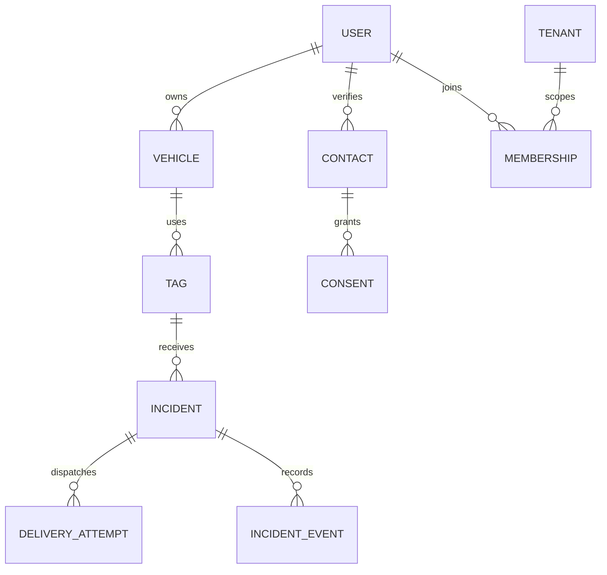

# Data model and API specification

> Implementation update, 18–19 October 2026: application code now exists. This document preserves the planning baseline; see [IMPLEMENTATION.md](IMPLEMENTATION.md) and [TESTING.md](TESTING.md).

This is a design specification, not an implemented migration. UUIDs are internal IDs. Public QR tokens use at least 128 random bits from a cryptographic generator, encoded URL-safe. Hash tokens at rest for lookup. Never encode phone, plate or sequential database ID in QR. A separate sealed claim secret has at least 128 random bits and a one-time hashed verification record. Public token and claim secret must never be interchangeable.

## Entities and constraints

| Entity | Key fields | Rules |
|---|---|---|
| users | id, auth_subject, locale, status | Auth subject unique; deleted/disabled blocks writes |
| contacts | id, user_id, encrypted_e164, phone_hmac, verified_at, key_version | Envelope encryption; HMAC lookup with separate secret; changes require verification |
| consents | contact_id, purpose, channel, version, granted_at, revoked_at | Append evidence; no send after withdrawal |
| vehicles | id, owner_id, make, color, optional_plate, status | Owner authorization; optional plate private by default |
| tag_batches | id, created_by, quantity, manifest_uri | Private manifest, supplier access expires |
| tags | id, vehicle_id, token_hash, claim_secret_hash, state, batch_id | Token unique; atomic claim; states unclaimed/active/paused/revoked |
| backup_links | vehicle_id, contact_id, priority, accepted_at | Separate contact consent; at most one fallback in A |
| tenants / memberships | tenant_id, user_id, role, status | Composite uniqueness; mandatory tenant scope |
| incidents | id, tag_id, scanner_session_hash, reason, state, expires_at | Reason enum, foreign keys, owner determined from tag at creation |
| incident_recipients | incident_id, contact_id, role, destination_version | Immutable intended identity; recheck current consent before dispatch |
| incident_events | id, incident_id, actor_type/id, kind, time | Append-only outcome/audit events, safe payload |
| delivery_attempts | incident_id, recipient_id, channel, stage, provider_id, state | Unique logical dispatch tuple; reconcile unknown submissions |
| outbox | id, event_type, reference_id, available_at, lease_until, state | Atomic with domain transaction; bounded lease |
| webhook_events | provider, provider_event_id/hash, received_at, processed_at | Unique provider/event; short encrypted raw retention if needed |
| call_sessions | incident_id, verified_scanner_contact, leg_ids, state, duration | B; no arbitrary destination from client; no audio recording default |
| orders / order_items | order_id, buyer_id, amount, currency, payment_status, tag allocation | Server-side pricing; verified payment reference |
| abuse_reports / blocks | reporter, incident_id, target session/tag, expiry, reason | Do not globally ban shared IP without review |
| audit_logs | actor, action, target, timestamp, request_id | Redacted payload; protected write path |

## Relationship diagram

## API inventory

| Endpoint | Principal | Contract / access boundary |
|---|---|---|
| GET /api/public/tags/{token} | Public | Allowlist: active, generic vehicle descriptor, allowed reason codes, locale. Uniform unavailable result for invalid/revoked. |
| POST /api/public/tags/{token}/incidents | Public session + challenge if needed | Body reason, optional location. Idempotency-Key required; server decides destinations. |
| GET /api/public/incidents/{id} | Incident-bound session | Return safe state and allowed actions, no contact records. |
| POST /api/public/incidents/{id}/cancel | Same scanner session | Cancel only own open incident, prevents pending dispatch. |
| POST /api/owner/tags/claim | Auth owner | Sealed secret, tag token, vehicle ID; transactional one-use claim. |
| GET/POST /api/owner/vehicles | Auth owner | Owner scope; validation and minimal attributes. |
| PATCH /api/owner/vehicles/{id} | Owning user | Optimistic version; contact changes separately verified. |
| POST /api/owner/incidents/{id}/ack | Intended authenticated contact | Action coming/unavailable/report; cross-owner access denied. |
| POST /api/owner/incidents/{id}/resolve | Owner | Record actor, do not fabricate scanner confirmation. |
| POST /api/owner/tags/{id}/pause,revoke,transfer | Owner | Reauthenticate sensitive changes, audit; revoke active sessions where needed. |
| POST /api/webhooks/whatsapp | Provider | GET verification handshake + signed POST raw payload validation. |
| POST /api/webhooks/sms | Provider | Supplier-supported authentication and replay defense. |
| POST /api/voice/requests | Verified scanner, B | Incident ID only plus verification reference; server resolves target. |
| POST /api/webhooks/voice | Provider, B | Validate identity and event order. |
| GET /api/site/incidents | Site membership | Tenant scope, redacted incident projection. |
| POST /api/admin/tag-batches | Fulfilment/admin | MFA, quantity cap, secure print artifact generation. |
| GET /api/admin/health | Operations | Aggregate channel failures, spend, backlog, no phone fields. |

contracts/openapi.yaml defines the first vertical slice only; the inventory above defines remaining routes for later implementation. Document error schemas consistently: invalid input 400, unauthenticated 401, unauthorized/not-found without enumeration 404 where appropriate, conflict 409, rate limit 429, retryable server error 503. Never return provider raw errors to public clients.

## Session and concurrency details

Use secure, HttpOnly, SameSite cookies and CSRF defenses for cookie-authenticated mutations. Public incident sessions use high-entropy opaque credentials, expire with the incident and are not indexed. Strip tokens from analytics and referer headers. A scanner session is not proof of a person’s identity. Voice requires a separately verified callback number. Idempotency keys bind principal+route+canonical body; reuse with different body is a conflict. Row-level lock/conditional UPDATE and unique constraints enforce claims, not frontend checks.
